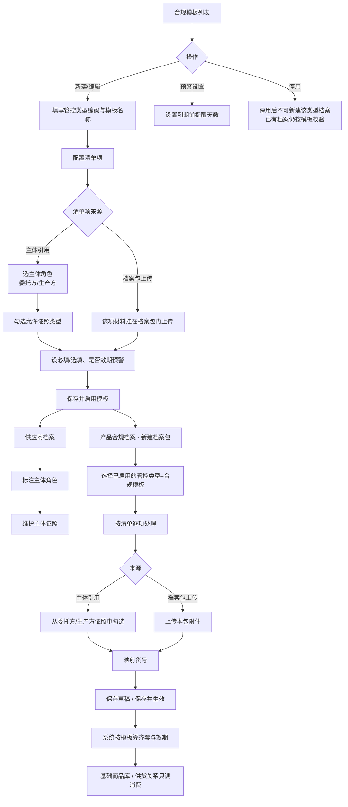

# 合规模板使用流程

> 关联 PRD：`docs/产品合规档案.md`  
> 原型：`SCM/master_data_compliance_template.html`

合规模板是「规则配置」：定义某管控类型下要备哪些材料。真正建档在 **产品合规档案**；主体证照在 **供应商档案**。

## 总览

## 步骤说明

### 1. 配置合规模板

1. 进入「合规模板」列表，新建或编辑模板。
2. 填写管控类型编码、模板名称（编码新建后不可改）。
3. 配置清单项（摘要列表浏览，嵌套层编辑）：
   - **主体引用**：指定委托方/生产方 + 允许证照类型（营业执照、生产许可证等）。
   - **档案包上传**：材料挂在档案包内，由业务上传附件。
   - 设置必要程度（必填/选填）、是否效期预警。
4. 保存并启用。可在列表页设置全局「到期前提醒天数」。

### 2. 准备主体证照

1. 供应商档案标注 **主体角色**（委托方 / 生产方）。
2. 在详情「主体证照」维护可复用证照（一处维护、多档案包引用）。
3. 厂房照片仍在供应商表单/详情中维护；执照类不走旧证照槽位。

### 3. 按模板建档案包

1. 产品合规档案 → 新建档案包。
2. 选择已启用的管控类型（即合规模板）。
3. 按清单逐项：
   - 主体引用项 → 从对应角色供应商的主体证照中勾选；
   - 档案包上传项 → 上传本包附件。
4. 映射货号 → 保存草稿或保存并生效。
5. 系统按模板计算齐套、效期；商品库 / 供货关系只读消费状态。

## 一句话

先在合规模板定义「要什么证」→ 供应商把主体证照备好 → 建档案包时选该模板，按清单引用或上传 → 商品侧看齐套结果。
